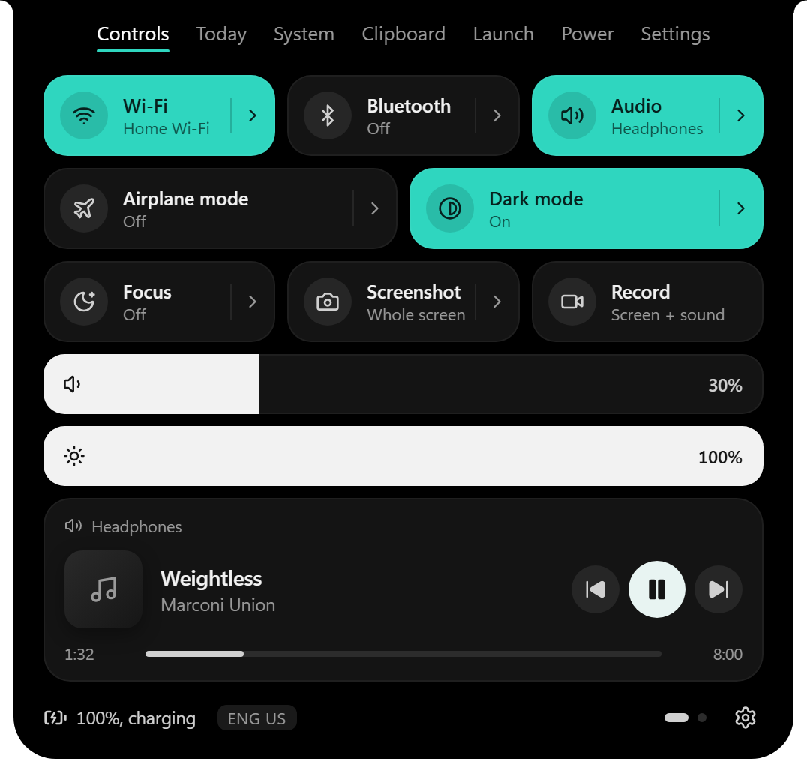

# Gabay

**Your Windows taskbar, folded into an iPhone-style notch.** Quick settings, your day and your tools, one hover away. Free and open source.

<p align="center">
  
</p>

<p align="center">
  <a href="https://github.com/IkariShinjiii/gabay/releases/latest"><b>Download</b></a> ·
  <a href="https://gabay-site-plum.vercel.app"><b>Live demo (website)</b></a> ·
  <a href="CHANGELOG.md">Changelog</a> ·
  <a href="CONTRIBUTING.md">Contribute</a> ·
  <a href="https://github.com/IkariShinjiii/gabay/discussions">Discussions</a>
</p>

**Install:** download **Gabay Setup** from the [latest release](https://github.com/IkariShinjiii/gabay/releases/latest) and run it.
**Run from source** (Node 24, Windows), one line:

```powershell
git clone https://github.com/IkariShinjiii/gabay; cd gabay; npm install; npm run dev
```

Built and tested on Windows 11; Windows 10 version 1809 or later should work.
Electron + React + TypeScript + electron-vite, with a small C# helper for the Windows parts (see CHANGELOG.md for history).

## Download

**Website:** https://gabay-site-plum.vercel.app

Get the installer from the website or from [GitHub releases](https://github.com/IkariShinjiii/gabay/releases/latest).
It's free, installs for your account only, and updates itself. Windows may say "Windows protected your PC" the first
time, because the installer isn't code-signed yet: choose **More info**, then **Run anyway**.
Works on laptops and desktop PCs: on a PC without a battery, Wi-Fi or Bluetooth, those controls are hidden and a wired
connection shows as Ethernet.

**Reviews:** rate Gabay with the [review form](https://github.com/IkariShinjiii/gabay/issues/new?template=review.yml).
Approved reviews (label `approved`) appear on the website, and approving one closes it automatically.

## Website

The site is the single static page in `site/`. It deploys to **Vercel** (project root `site/`, settings in
`site/vercel.json`: caching for media, fonts and images, plus security headers) on every push to `main`, and to GitHub
Pages (https://ikarishinjiii.github.io/gabay/) through `.github/workflows/pages.yml`. The showcase video is made with
Remotion in a separate `gabay-video` project (`src/Showcase.tsx`); re-encode it for the web at 1600 px with a capped
bitrate so it streams without stalling.

## Setup

```powershell
npm install
```

If `npm run dev` fails with `Electron uninstall`, the Electron binary was not downloaded:

```powershell
node node_modules/electron/install.js
```

If the main process crashes with `Cannot read properties of undefined (reading 'whenReady')`, your shell has
`ELECTRON_RUN_AS_NODE` set. Clear it (`Remove-Item Env:ELECTRON_RUN_AS_NODE`) and retry.

## Run in dev

```powershell
npm run dev
```

Other scripts: `npm run build`, `npm run typecheck`. Quit from the tray icon (right-click, Quit) or with Ctrl+C in the terminal.

## Features

Each part of Gabay has its own page:

- [Taskbar](docs/taskbar.md): the taskbar: hiding it and using the dock
- [Launcher and hotkey](docs/launcher.md): search apps, files and commands, and the hotkey
- [Power tab](docs/power.md): lock, sleep, restart and shut down
- [Clipboard tab](docs/clipboard.md): clipboard history
- [Today tab, focus timer and command bar](docs/today.md): your day, the focus timer and the command bar
- [Controls tab and status](docs/controls.md): quick settings and status
- [Live activities and alerts](docs/live-activities.md): now playing, downloads, alerts and notifications
- [Tray, Settings and startup](docs/settings.md): the tray, Settings and starting with Windows
- [Development notes](docs/development.md): where things live, the kill-test checklist and the dev preview

## Build an installer

```
npm run dist
```

Produces `dist/Gabay Setup <version>.exe` (unsigned, so Windows SmartScreen warns on first run). The config uses the local Electron copy (`electronDist`) because downloading and renaming a fresh one hit an EPERM lock on this machine.

## Credits

Icons are from [Lucide](https://lucide.dev) (ISC license), stored as inline SVG data in `src/icons.ts`.

## License

Copyright (c) 2026 IkariShinjiii. Gabay is free software under the **GNU General Public License v3.0 only**
([LICENSE](LICENSE)). You may use, study, change and share it. If you share a changed version, you must share its source
code under the same license. Gabay comes with no warranty.

**Name and logo:** the GPL covers the code, not the name. A changed version you share must use a different name and
icon, so people can tell it apart from official Gabay. Official downloads come only from
https://gabay-desktop.vercel.app and https://github.com/IkariShinjiii/gabay/releases.

Third-party software it includes is listed in [resources/THIRD-PARTY-NOTICES.txt](resources/THIRD-PARTY-NOTICES.txt).

## Code signing

See [docs/CODE_SIGNING.md](docs/CODE_SIGNING.md) for how releases are built and signed, and what Gabay connects to.
